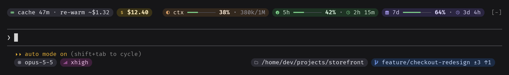
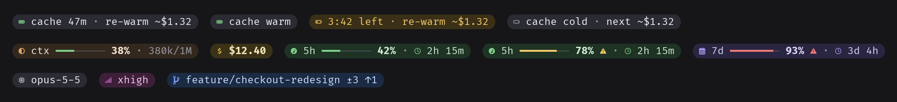
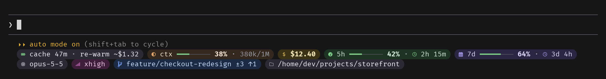

# pillbar

[English](README.md) | Português

Pílulas em tempo real acima (`banner`) e abaixo (`statusLine`) do prompt do Claude Code: a contagem do cache de prompt e quanto custa reescrevê-lo, o uso do contexto, o custo da sessão, os limites de 5h e 7d, o modelo, o effort, a branch e a pasta do projeto. Cada pílula tem um slug, e o comando `/pillbar layout` diz em que linha e de que lado ela fica.



Esse layout sai destes três comandos:

```
/pillbar layout banner row(0) left cache,cost right ctx,5h,7d
/pillbar layout statusLine clear
/pillbar layout statusLine row(0) left model,effort right folder,branch
```

## Instalação

No prompt de uma sessão do Claude Code no terminal:

```
/plugin install pillbar --marketplace andrevfarias/pillbar
```

Responda `y` para adicionar o marketplace e escolha o escopo.

Pelo shell:

```
claude plugin install pillbar --marketplace andrevfarias/pillbar
```

No app desktop, onde `/plugin` não roda: clique no + ao lado da caixa do prompt, depois em Plugins, Add marketplace com `andrevfarias/pillbar`, e Add plugin.

O repositório é privado: a instalação só funciona para quem tem acesso a ele no GitHub e uma credencial git para github.com na máquina (uma chave SSH, ou `gh auth login` seguido de `gh auth setup-git`). A instalação não pede a credencial.

## Requisitos

- Claude Code com suporte a mods (testado na 2.1.310).
- Uma Nerd Font no terminal para os ícones e as pontas arredondadas das pílulas. Sem ela, use `PILLBAR_ICONS=unicode`.

## Layout

```
/pillbar layout                                           mostra o layout e os slugs
/pillbar layout statusLine row(0) left cache,ctx right 5h,7d
/pillbar layout banner row(0) right cost
/pillbar layout statusLine row(1)                         mostra a linha
/pillbar layout statusLine row(1) right clear             limpa um lado
/pillbar layout banner row(0) clear | banner clear | clear | reset
```

- `banner` fica acima do prompt; `statusLine`, abaixo da linha de dicas do Claude Code. As linhas contam de `row(0)` a `row(9)`.
- Uma linha não configurada entre duas configuradas fica em branco; um slug repetido aparece duas vezes; o lado que o comando não informa fica como está.
- O layout é um só para todas as sessões e projetos, e uma mudança chega às sessões abertas em até 5 s.
- O autocomplete sugere a próxima palavra do comando e, numa lista, o slug depois da vírgula.

| Slug | Pílula |
| --- | --- |
| `cache` | quanto falta para o cache esfriar e quanto custa reescrevê-lo (`~`, estimado) |
| `ctx` | uso do contexto |
| `cost` | custo da sessão |
| `5h`, `7d` | limites da conta, com a renovação |
| `model` | modelo |
| `effort` | effort |
| `branch` | branch, arquivos alterados, à frente e atrás |
| `folder` | pasta do projeto: o caminho inteiro quando cabe, senão o nome |

As pílulas e os seus estados: o cache quente, durante um turno, nos últimos minutos e frio; o contexto e o custo; os limites abaixo de 70%, a partir de 70% e a partir de 90%; o modelo, o effort e a branch.



O padrão é `statusLine row(0)` com `cache, ctx, cost, 5h, 7d` e `row(1)` com `model, effort, branch, folder`:



Uma linha que não cabe na largura perde detalhe (barras, tokens, textos longos) em vez de quebrar.

## Configuração

| Variável | Valores |
| --- | --- |
| `PILLBAR_APPEARANCE` | `dark` (padrão), `light` ou `plain` (sem fundo, cores do tema) |
| `PILLBAR_ICONS` | `nerd` (padrão) ou `unicode` |
| `NO_COLOR` | força `plain` |

## Como lê os números

- O cache conta a partir da última requisição da conversa principal, com o TTL de 1h, a menos que `FORCE_PROMPT_CACHING_5M`, `CLAUDE_CODE_PROMPT_CACHE_TTL`, `promptCacheTtl` ou `ENABLE_PROMPT_CACHING_1H` fixem outro. Uma sessão retomada lê a última resposta do transcript. O custo do re-warm é a janela inteira a 1,25× o preço de input do modelo, como o contador de custo do Claude Code cobra.
- Os limites de 5h e 7d são da conta: cada sessão deixa a sua leitura no store do mod, e toda sessão mostra a mais nova. Uma janela cuja renovação passou aparece com 0% até a próxima leitura.
- Um ping de keepwarm (o do cache-tax, por exemplo) que leu o cache reinicia a contagem.
